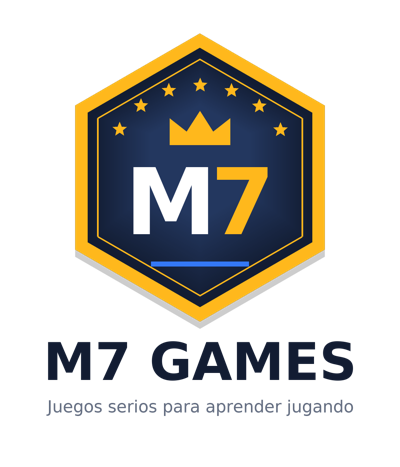
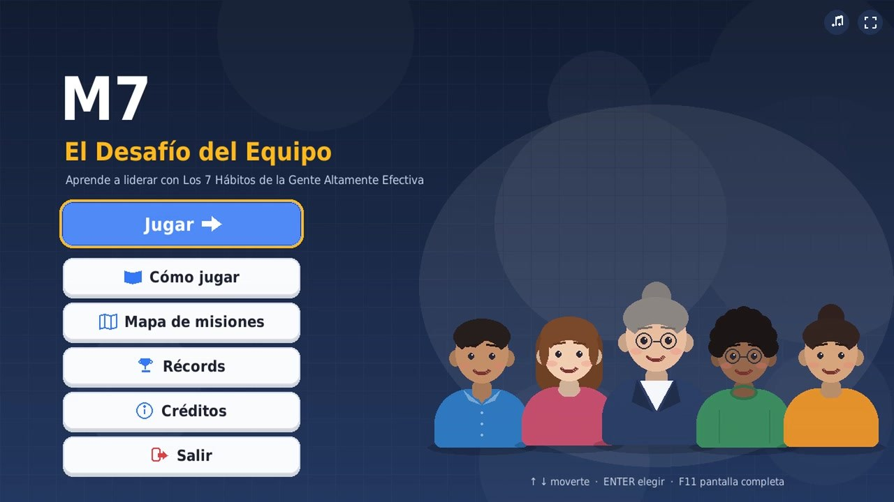
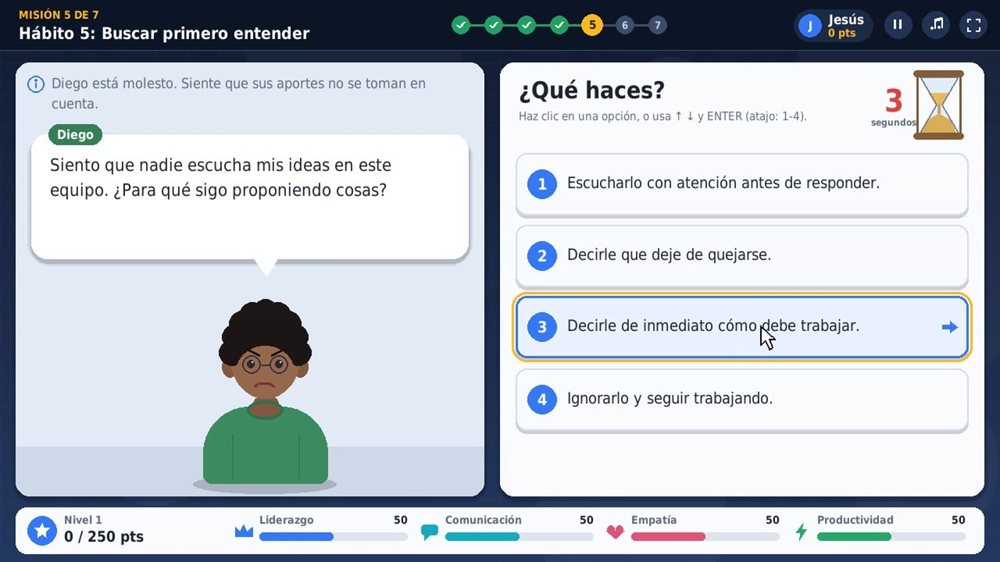
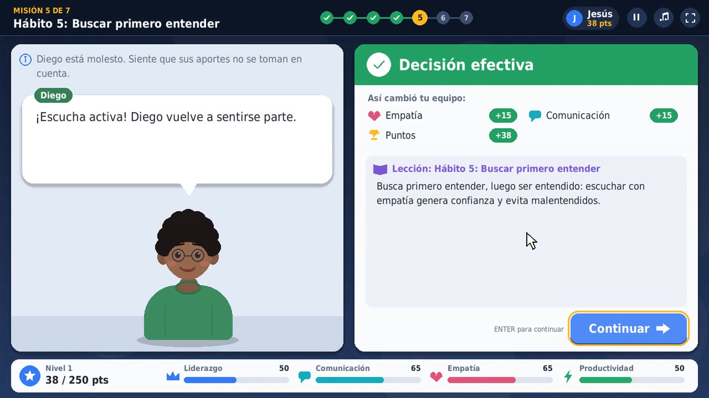
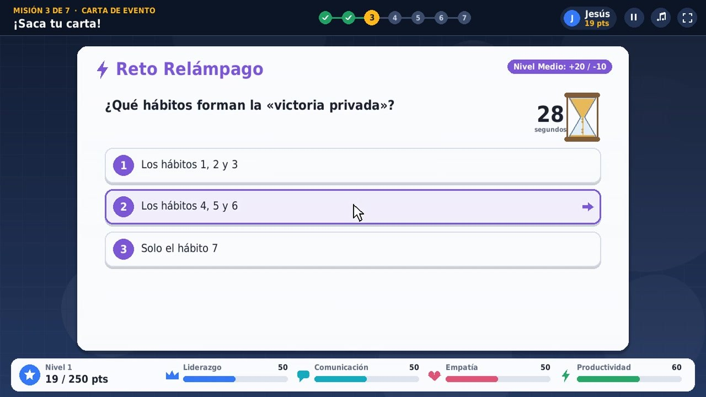
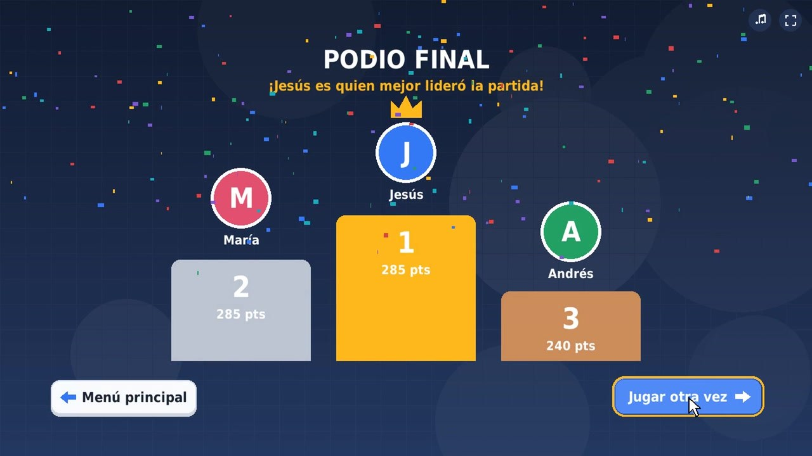

<p align="center">
  
</p>

<h1 align="center">M7: El Desafío del Equipo</h1>

<p align="center">
  Juego serio digital basado en <em>Los 7 hábitos de la gente altamente efectiva</em> de Stephen R. Covey.<br>
  <strong>M7</strong>: la <strong>M</strong> de Misión y el <strong>7</strong> de los 7 Hábitos.
</p>

<p align="center">
  <a href="https://utpac-my.sharepoint.com/:v:/g/personal/jesus_jacinto_utp_ac_pa/IQB4s9nWr4hZQLc1c27EI50BAa0PGVoyYHP0DaR4W0kROoc?nav=eyJyZWZlcnJhbEluZm8iOnsicmVmZXJyYWxBcHAiOiJPbmVEcml2ZUZvckJ1c2luZXNzIiwicmVmZXJyYWxBcHBQbGF0Zm9ybSI6IldlYiIsInJlZmVycmFsTW9kZSI6InZpZXciLCJyZWZlcnJhbFZpZXciOiJNeUZpbGVzTGlua0NvcHkifX0&e=l23N5p"><strong>▶ Ver el video de presentación</strong></a>
</p>

---

## ¿De qué trata?

Eres el líder de un equipo universitario (Carlos, Sofía, Diego y Ana) que debe entregar un proyecto en 30 días. A lo largo de **7 misiones**, una por cada hábito, enfrentas situaciones reales de trabajo en equipo y eliges entre cuatro decisiones. Cada decisión cambia cuatro habilidades del equipo: **liderazgo, comunicación, empatía y productividad**. Después de cada una, el juego explica la lección del hábito.

El objetivo es practicar las habilidades blandas que casi siempre se enseñan solo de forma teórica: equivocarte sin consecuencias reales, ver el efecto de tus decisiones al instante y repetir hasta mejorar.

## Capturas

| Menú principal | Misión con reloj de arena |
|:---:|:---:|
|  |  |
| **Resultado y lección del hábito** | **Reto Relámpago** |
|  |  |

<p align="center"><br><em>Podio final en modo multijugador</em></p>

## Características

- **Interfaz gráfica** con personajes ilustrados, globos de diálogo, reloj de arena animado y cartas que se voltean.
- **1 a 4 jugadores** por turnos en la misma computadora.
- **Tres dificultades:** Aprendiz (con pistas y sin límite de tiempo), Líder (30 s por decisión) y Líder Experto (15 s por decisión, castigos más fuertes y más puntos).
- **Cartas de evento** tras cada misión: bonificación, penalización o **Reto Relámpago**, donde eliges cuánto arriesgar antes de ver la pregunta.
- **Rachas, niveles y 10 insignias** por descubrir.
- **Tabla de récords** que se guarda sola y se puede limpiar con un botón.
- **Muerte súbita** de preguntas difíciles si hay empate en multijugador.
- **Voz del autor** que explica las reglas en «Cómo jugar» y cada misión en el «Mapa de misiones».
- Se maneja con **ratón o teclado**, y se adapta a cualquier tamaño de ventana o a pantalla completa.

## Las 7 misiones

| # | Hábito | Idea clave | Insignia |
|:-:|---|---|---|
| 1 | Ser proactivo | Tomar la iniciativa en lugar de esperar. | Líder Proactivo |
| 2 | Comenzar con un fin en mente | Tener claro el objetivo antes de avanzar. | Visión Compartida |
| 3 | Poner primero lo primero | Priorizar lo importante sobre lo urgente o fácil. | Maestro de Prioridades |
| 4 | Pensar ganar/ganar | Buscar acuerdos donde todos se beneficien. | Mediador |
| 5 | Buscar primero entender | Escuchar con empatía antes de responder. | Escucha Activa |
| 6 | Sinergizar | Combinar las fortalezas de todos. | Equipo Sinérgico |
| 7 | Afilar la sierra | Renovarse para rendir a largo plazo. | Equipo Equilibrado |

**Cómo se gana:** termina con **250 puntos o más** y un **promedio de habilidades de 60 o más**.

## Instalación y ejecución

Necesitas **Python 3** y la librería **Pygame**.

### Ubuntu / Linux

```bash
git clone https://github.com/TU_USUARIO/M7-El-Desafio-del-Equipo.git
cd M7-El-Desafio-del-Equipo
chmod +x instalar.sh jugar.sh
./instalar.sh      # instala Pygame y crea el acceso directo «M7» en el menú
./jugar.sh
```

Para instalar Pygame a mano: `sudo apt install python3-pygame`. Si prefieres un entorno virtual, sigue las instrucciones de [`INSTALACION.txt`](INSTALACION.txt).

### Windows / macOS

```bash
pip install -r requirements.txt
python mision7_gui.py
```

### Versión de terminal (sin Pygame)

```bash
python3 mision7_terminal.py
```

## Controles

| Acción | Teclas |
|---|---|
| Elegir una opción | Clic, o ↑ ↓ / ← → y ENTER |
| Atajo de decisión | Teclas 1 a 4 |
| Leer el diálogo más rápido | ESPACIO o clic |
| Pausa | ESC o P |
| Pantalla completa | F11 |
| Repetir la voz en «Cómo jugar» | R |

## Estructura del proyecto

```
M7-El-Desafio-del-Equipo/
├── mision7_gui.py        # programa principal (interfaz gráfica)
├── contenido.py          # misiones, preguntas, cartas e insignias
├── logica.py             # reglas: puntaje, cartas, victoria y récords
├── graficos.py           # personajes, reloj de arena, botones e íconos dibujados con código
├── audio.py              # música y efectos de sonido generados con código
├── mision7_terminal.py   # versión de respaldo para terminal
├── sonidos/              # música y efectos (.wav) creados por audio.py
├── voz/                  # grabaciones del autor para «Cómo jugar» y el mapa de misiones
├── capturas/             # imágenes de este README
├── instalar.sh / jugar.sh
├── requirements.txt
└── INSTALACION.txt       # guía detallada de instalación y solución de problemas
```

Para agregar misiones o preguntas solo hay que editar `contenido.py`: el contenido, las reglas y la interfaz están separados.

## Diseño de gamificación

- **Modelo de Werbach y Hunter:**
  - Dinámicas: narrativa, competencia y progresión.
  - Mecánicas: puntos, niveles, retos, rachas y turnos.
  - Componentes: insignias, barras, cartas y récords.
- **Perfiles de jugador de Bartle:**
  - El Triunfador colecciona insignias.
  - El Explorador descubre las lecciones.
  - El Sociable juega por turnos.
  - El Competidor busca el podio.

## Créditos

- **Diseño, programación, ilustraciones, música, efectos y voz:** Jesús Jacinto Fabián · M7 Games.
- **Personajes, íconos y cartas:** dibujados con código en Pygame, sin imágenes de terceros.
- **Música y efectos de sonido:** compuestos y sintetizados con código en `audio.py` (obra original).
- **Contenido educativo:** basado en *Los 7 hábitos de la gente altamente efectiva*, de Stephen R. Covey (1989).

### Tecnologías y licencias de terceros

- [Python 3](https://www.python.org/): licencia PSF.
- [Pygame](https://www.pygame.org/): licencia LGPL 2.1.
- Fuente [DejaVu Sans](https://dejavu-fonts.github.io/): licencia libre.

## Contexto académico

Proyecto del curso **Sistemas Colaborativos** con el Prof. Dr. Ramfis Miguelena. Universidad Tecnológica de Panamá, Facultad de Ingeniería de Sistemas Computacionales, Licenciatura en Ciberseguridad, II Semestre 2026.

---

<p align="center">© 2026 M7 Games · Jesús Jacinto Fabián</p>
